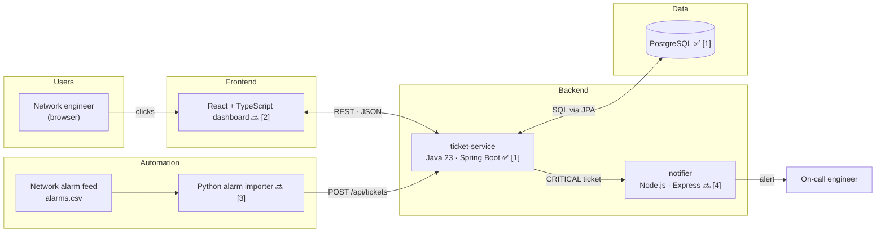
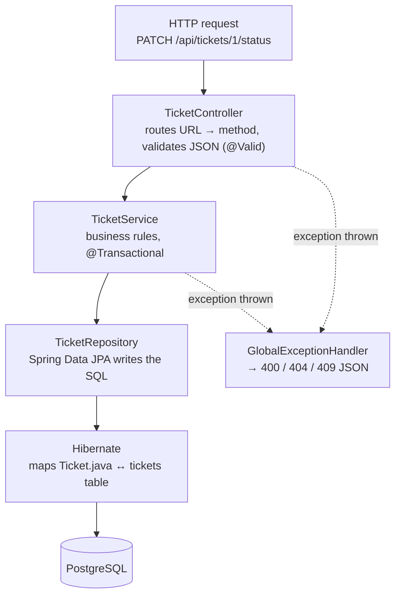
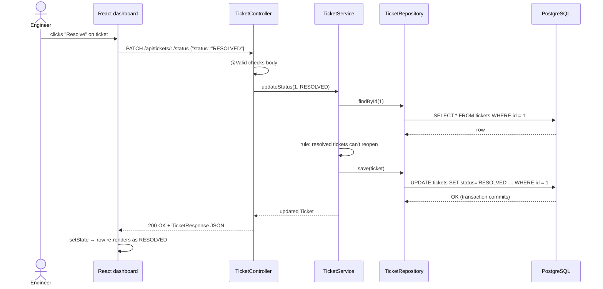
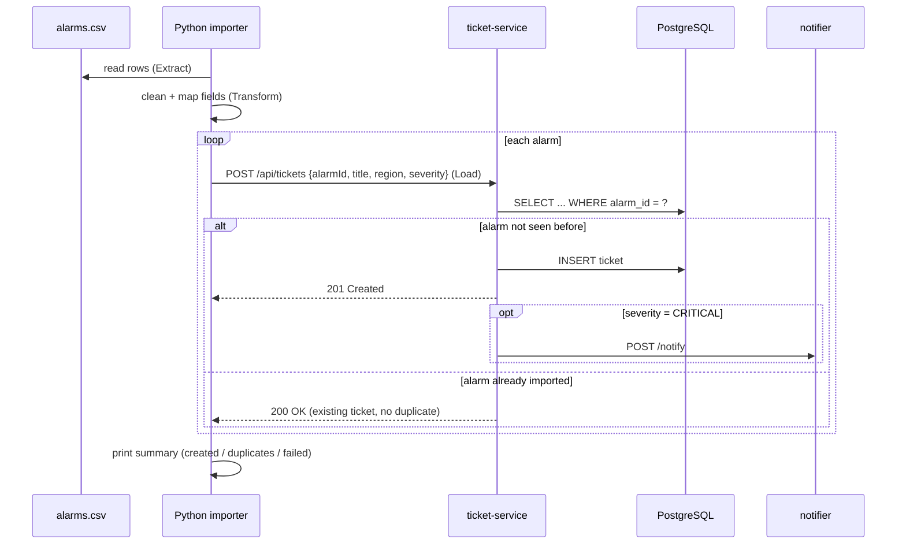
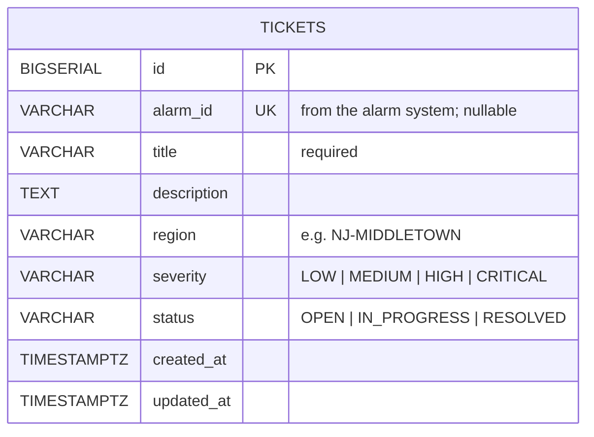
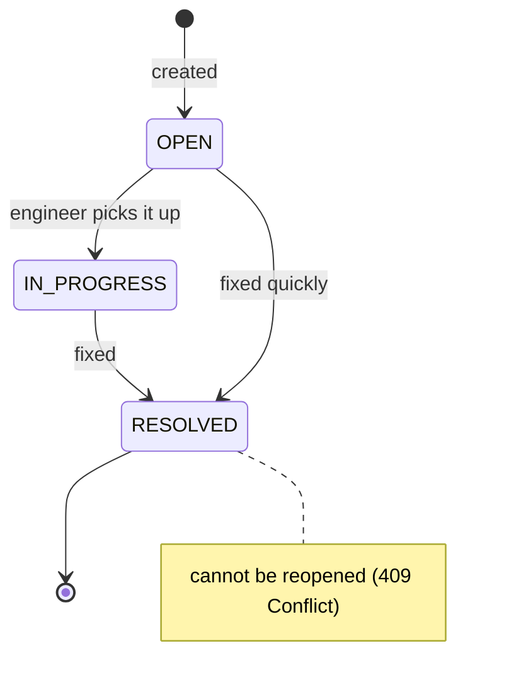
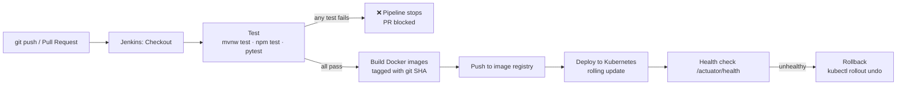
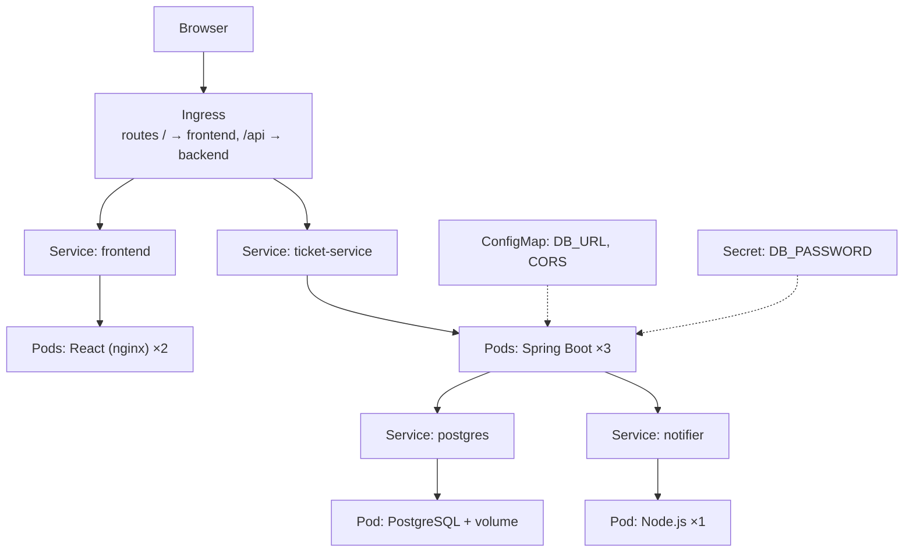

# NetTrack Architecture

NetTrack turns network alarms into outage tickets that engineers track and resolve on a dashboard.

- **Status legend:** ✅ built · 🔜 planned (part number in brackets)

---

## 1. System overview



Every box above runs as a **Docker container** 🔜 [5], managed by **Kubernetes** 🔜 [6], and shipped by a **Jenkins** pipeline 🔜 [7].

| Component | Language / tool | Job | Port |
|---|---|---|---|
| React dashboard | TypeScript, React, Vite | Shows tickets, lets engineers change status | 5173 |
| ticket-service | Java 23, Spring Boot 3.3, Maven | Owns tickets: rules, validation, storage | 8080 |
| PostgreSQL | SQL, Flyway migrations | Stores tickets permanently | 5432 |
| Alarm importer | Python 3.11 | Reads alarm files, creates tickets (ETL) | — (script) |
| notifier | Node.js, Express | Sends alerts for CRITICAL tickets | 3001 |

---

## 2. Inside ticket-service (the layers)



| Layer | File | Rule of thumb |
|---|---|---|
| Controller | `TicketController.java` | HTTP only: URLs, status codes, DTOs. No business logic. |
| DTOs | `TicketDtos.java` | The JSON contract. Validation annotations live here. |
| Service | `TicketService.java` | All business rules. Easy to unit test with a mocked repository. |
| Repository | `TicketRepository.java` | Database access. Method names become SQL. |
| Entity | `Ticket.java` | One object = one row in `tickets`. |
| Errors | `GlobalExceptionHandler.java` | Turns exceptions into clean HTTP errors. |
| Config | `application.yml`, `WebConfig.java` | Env-var driven settings, CORS. |
| Schema | `db/migration/V1__create_tickets.sql` | Flyway runs it once, on startup. |

---

## 3. Flow: engineer resolves a ticket (full stack)



---

## 4. Flow: network alarm becomes a ticket (automation + idempotency)



**Why idempotency:** the importer may crash halfway and be re-run, or retry after a timeout. Re-sending an alarm must never create a second ticket. The service checks `alarm_id` first, and the database `UNIQUE` constraint is the final safety net.

---

## 5. Data model



Index `idx_tickets_status_created (status, created_at DESC)` matches the dashboard's main query: open tickets, newest first.

### Ticket lifecycle



---

## 6. CI/CD pipeline (Jenkins) 🔜 [7]



---

## 7. Deployment on Kubernetes 🔜 [6]



- **Deployment** keeps the requested number of pods running and replaces crashed ones.
- **Service** gives pods one stable name (`ticket-service:8080`) and load-balances between them.
- **Probes** call `/actuator/health`; a pod gets traffic only when healthy.

---

## 8. Running locally (Part 1)

```bash
# Postgres (one time)
psql postgres -c "CREATE ROLE nettrack LOGIN PASSWORD 'nettrack';"
psql postgres -c "CREATE DATABASE nettrack OWNER nettrack;"

# Backend
cd backend
./mvnw test             # run tests
./mvnw spring-boot:run  # start API on :8080

# Try it
curl -X POST localhost:8080/api/tickets -H 'Content-Type: application/json' \
  -d '{"alarmId":"ALM-1001","title":"Fiber cut","region":"NJ-MIDDLETOWN","severity":"CRITICAL"}'
curl localhost:8080/api/tickets
```
