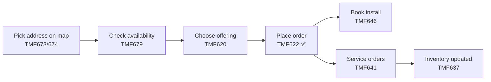
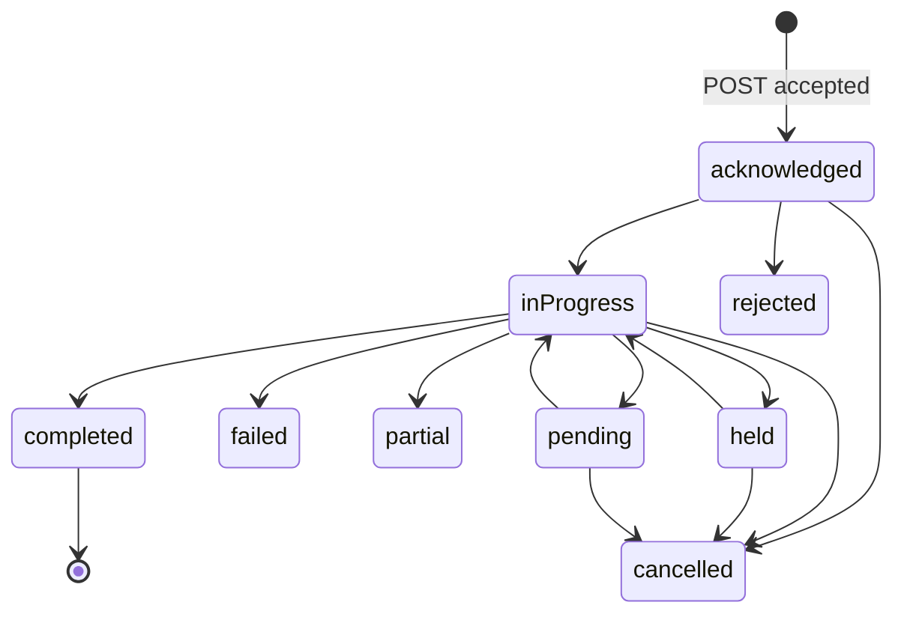

# Partner Ordering API (TMF622)

Partners (resellers, enterprise customers) order telecom products such as business fiber through a
**TM Forum TMF622 Product Ordering Management v4** API. TM Forum Open APIs are the industry-standard
contracts telecom operators use so every partner integrates the same way.

- Base path: `/tmf-api/productOrderingManagement/v4`
- OpenAPI 3 spec: [`openapi.json`](openapi.json) (live at `/v3/api-docs`, Swagger UI at `/swagger-ui.html`)

| Method | Path | What it does |
|---|---|---|
| POST | `/productOrder` | Place an order. **201** new · **200** same `externalId` retried (no duplicate) |
| GET | `/productOrder?state=inProgress` | List orders, optional state filter |
| GET | `/productOrder/{id}` | One order; `ETag` header carries its version |
| PATCH | `/productOrder/{id}` | **Amend** items/dates/description and/or change `state`. `If-Match` → **412** if stale |
| POST | `/cancelProductOrder` | Cancel an order (TMF models cancellation as its own resource) |

## Related TM Forum APIs (how a full partner portal fits together)

| API | Name | Role in a partner order flow |
|---|---|---|
| TMF620 | Product Catalog | What can be sold: offerings like `FIBER-1G` (our `productOffering.id`) |
| TMF674 / TMF673 | Geographic Site / Address | Where it's delivered: the map-picked address (our `place`) |
| TMF679 | Product Offering Qualification | "Is fiber available at this address?" before ordering |
| **TMF622** | **Product Ordering** | **Place and track the order (built here)** |
| TMF641 | Service Ordering | Internal: turns the product order into network service orders |
| TMF646 | Appointment | Book the technician install slot |
| TMF637 | Product Inventory | What the partner owns once the order completes |



## Order lifecycle



Amendments are allowed in `acknowledged`, `inProgress`, `pending`, `held`. Final states return **409**.

## Reliability design

| Problem | Solution in the code |
|---|---|
| Partner times out and **retries** the POST | `(partner_id, external_id)` is unique; a retry returns the original order with 200 |
| Two retries arrive at the **same instant** | Database `UNIQUE` constraint rejects the second (409); its next retry gets 200 |
| Two people **amend** the same order at once | `ETag` / `If-Match` + JPA `@Version`: the stale writer gets 412 and re-reads |
| Order saved but event **lost** (or event sent, save failed) | **Transactional outbox**: event row written in the same DB transaction, relay publishes after |
| Event published **twice** after a crash | At-least-once delivery; consumers dedupe by event id |
| Amending items hits unique constraint | Items merged in place by `id` (Hibernate flushes INSERTs before DELETEs) |
| `LazyInitializationException` on retry | `@EntityGraph` loads items with the order; caught by the Testcontainers integration test |

```mermaid
sequenceDiagram
    participant P as Partner system
    participant API as Order API
    participant DB as PostgreSQL
    participant R as Outbox relay
    participant K as Kafka (Part 5)

    P->>API: POST /productOrder (externalId=ACME-PO-1001)
    API->>DB: BEGIN; INSERT product_orders + items + order_events; COMMIT
    API--xP: response lost (timeout)
    P->>API: retry POST (same externalId)
    API->>DB: SELECT by (partner, externalId) → found
    API-->>P: 200 OK, original order
    R->>DB: SELECT unpublished events
    R->>K: publish ProductOrderCreateEvent (key = order id)
    R->>DB: mark published
```

## Try it

```bash
B=localhost:8080/tmf-api/productOrderingManagement/v4
curl -i -X POST $B/productOrder -H 'Content-Type: application/json' -d '{
  "externalId":"ACME-PO-2001",
  "relatedParty":[{"id":"PARTNER-ACME","role":"Partner"}],
  "productOrderItem":[{"id":"1","action":"add","quantity":1,
    "productOffering":{"id":"FIBER-1G","name":"Business Fiber 1 Gig"},
    "place":{"id":"SITE-77","@referredType":"GeographicSite"}}]}'
```
